<div align="center">

<a href="https://github.com/ASCIT31/Dark-Moon">
  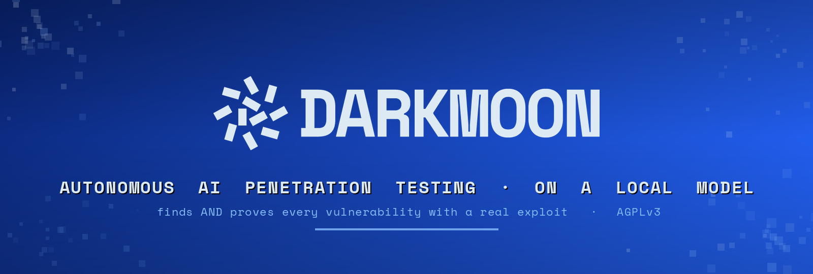
</a>

# DarkMoon

### Open-source autonomous AI penetration testing — finds, exploits and qualifies every vulnerability on your own infrastructure

<p>
<a href="https://github.com/ASCIT31/Dark-Moon"></a>
<a href="https://github.com/ASCIT31/Dark-Moon/releases"></a>
<a href="https://www.gnu.org/licenses/agpl-3.0"></a>
<a href="#quick-start"></a>
<a href="https://github.com/ASCIT31/Dark-Moon"></a>
</p>

[**⭐ Star DarkMoon**](https://github.com/ASCIT31/Dark-Moon) · [**🚀 Quick Start**](#quick-start) · [**🧩 Integrations**](#-darkmoon-everywhere) · [**📊 Benchmark**](#-benchmark-57-real-vulnerabilities-on-owasp-juice-shop) · [**🔬 Research**](#research-benchmarks--technical-publications) · [**🔒 Darkmoon Pro**](#-darkmoon-pro--paid-edition-web-dashboard-and-automated-remediation) · [**▶️ Install & Run (OSS)**](https://youtu.be/3Qv1luvW99E) · [**▶️ Demo (Pro)**](https://youtu.be/zQE95bVLZgM)

</div>

> [!IMPORTANT]
> **License change.** Darkmoon Community is moving from the GNU GPL v3.0 to the GNU AGPL v3.0. Every commit published up to `edfe9cb` (27 October 2026) stays under the GNU GPL v3.0; `master` is under the AGPL v3.0 since 19 November 2026 (PR #59), and [v1.7.0](https://github.com/ASCIT31/Dark-Moon/releases/tag/v1.7.0) (20 November 2026) is the first AGPL release (v1.6.0 and earlier stay GPL v3.0). The contributions made by outside contributors before the switch also stay under the GNU GPL v3.0 (they are not relicensed). Details: [LICENSING.md](https://github.com/ASCIT31/Dark-Moon/blob/master/LICENSING.md).

**DarkMoon is autonomous AI penetration testing for your own infrastructure.** Point it at an authorized target and it runs the whole assessment on its own, then documents every finding with the exact command and raw output.

- 🟢 **Truly open source.** AGPLv3 and self-hosted, every agent's methodology is plain Markdown you can read, diff and fork.
- 🎯 **Finds AND proves.** Each vulnerability ships with the exact command and raw output (exploitation is agent-asserted; the Pro remediation retest is the machine-verified step), so there is almost nothing to triage.
- 🔒 **Runs on a local LLM + Privacy Gateway.** The gateway tokenizes your real IPs, hosts and credentials locally, so the model reasons on placeholders while real values stay on your perimeter.
- 🕸️ **An attack-path graph you can check.** Agents declare what enabled what; the server keeps each link as a hypothesis (**Possible Attack Path**) and promotes it to **Evidence-Backed** only on its own records, with no model call to qualify it. Paths, their limits and the research behind them, including our local expert-AI prototype (research, not shipped): [Attack paths](https://dark-moon.org/infrastructure-graph/) · [Research](https://github.com/ASCIT31/darkmoon-attack-paths-research).
- 🧩 **Everywhere you build.** Run it from GitHub, GitLab, Jenkins, VS Code, JetBrains, n8n, Grafana or Splunk — the open-source edition works with the CLI-based ones. [See the integrations ↓](#-darkmoon-everywhere)

---

<div align="center">

## See the open source engine (CLI)

The open source Darkmoon is a command line tool. This is what you get when you clone the repo. You launch an assessment from the command line and watch every agent, command and finding stream past in real time.

</div>

<div align="center">
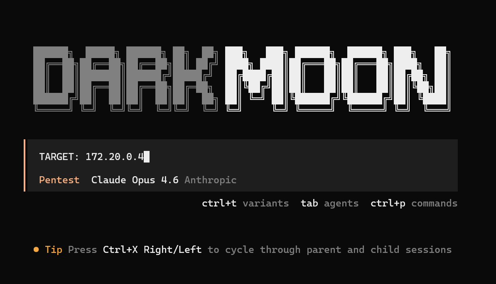
<p><b>Kick off a run from the CLI.</b> One <code>TARGET</code> line and DarkMoon takes over the whole assessment.</p>
</div>

<p align="center"><b>Then explore the results in the Terminal Explorer</b> (type <code>/explore</code> in the console):</p>

<table>
<tr>
<td width="50%" valign="top">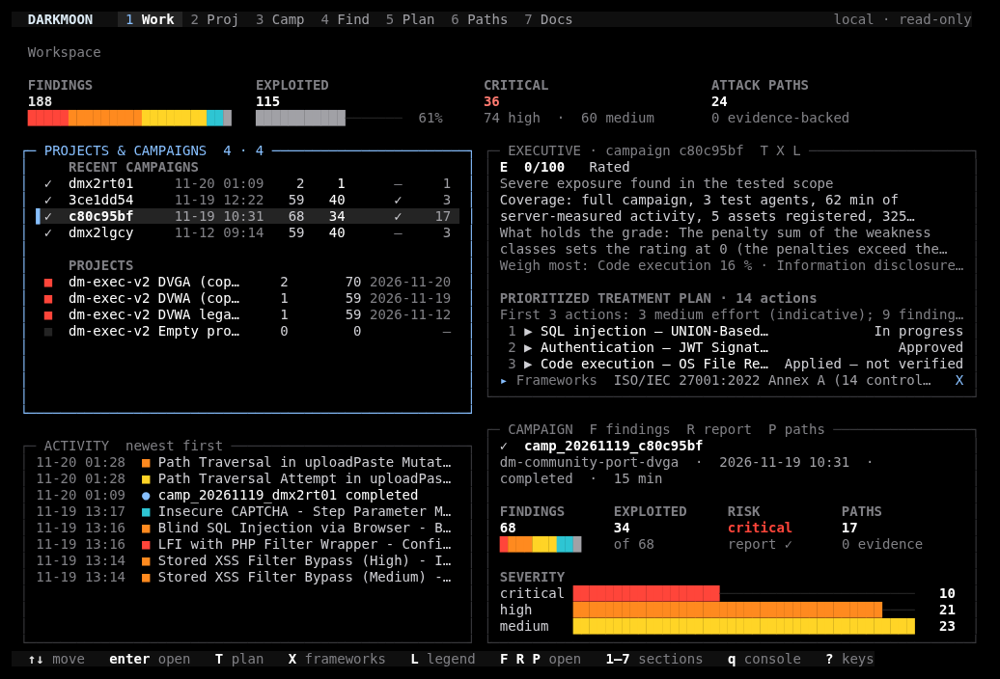<p align="center"><b>Workspace.</b> Executive block of a campaign.</p></td>
<td width="50%" valign="top">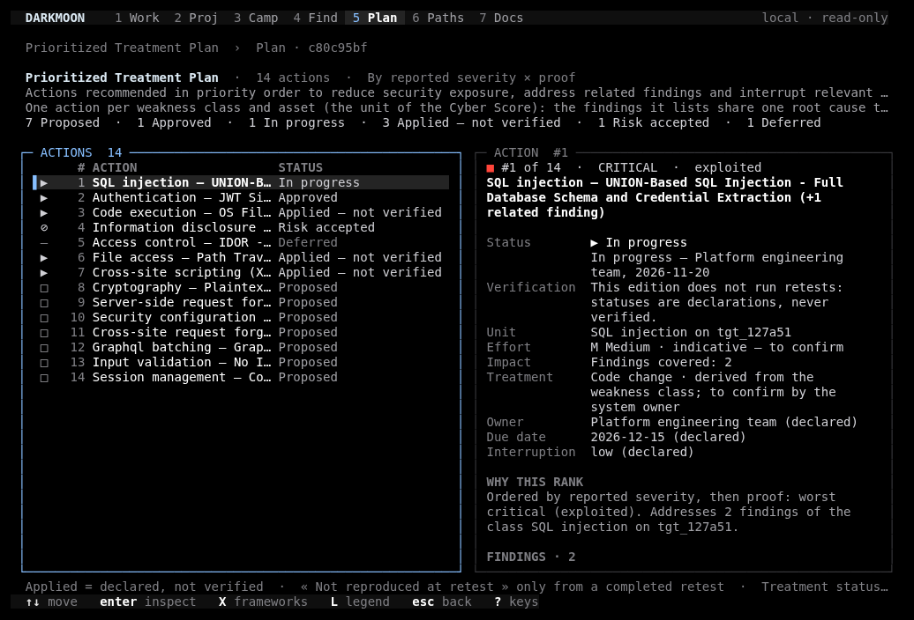<p align="center"><b>Prioritized Treatment Plan.</b></p></td>
</tr>
<tr>
<td width="50%" valign="top">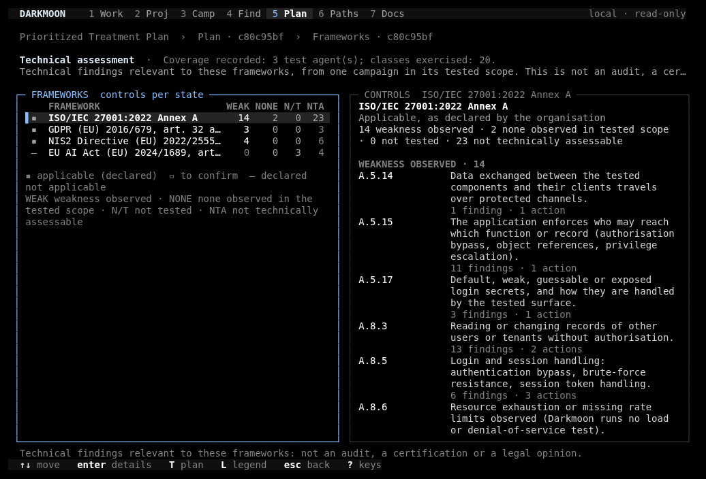<p align="center"><b>Framework technical assessment.</b></p></td>
<td width="50%" valign="top">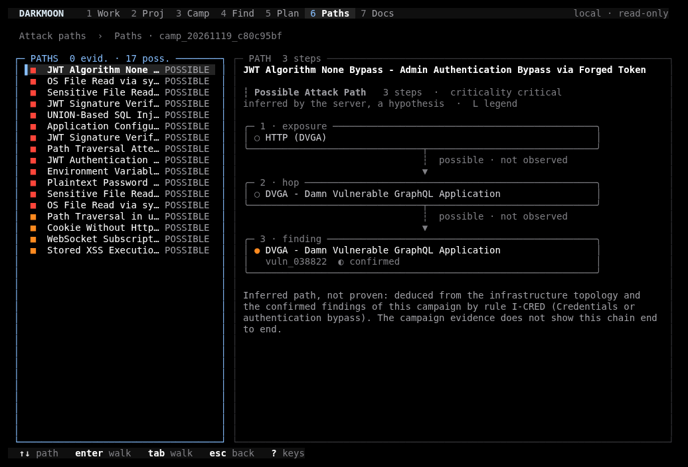<p align="center"><b>Attack paths</b> (Possible in Community).</p></td>
</tr>
</table>

<p align="center"><sub>Community edition captures, data from a campaign on a local DVGA lab.</sub></p>

<table>
<tr>
<td width="50%" valign="top">
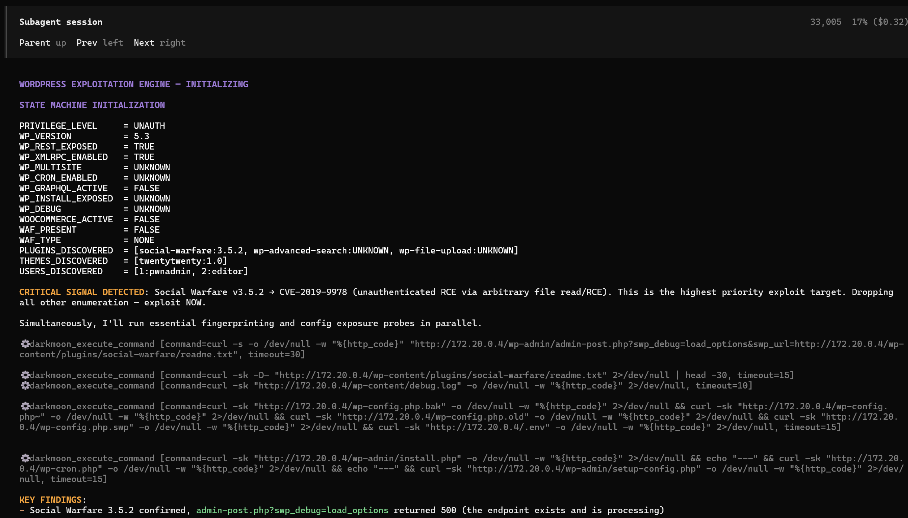
<p align="center"><b>Autonomous agents reason and exploit, live in your terminal.</b> Here a sub-agent flags CVE-2019-9978 and pivots straight to exploitation.</p>
</td>
<td width="50%" valign="top">
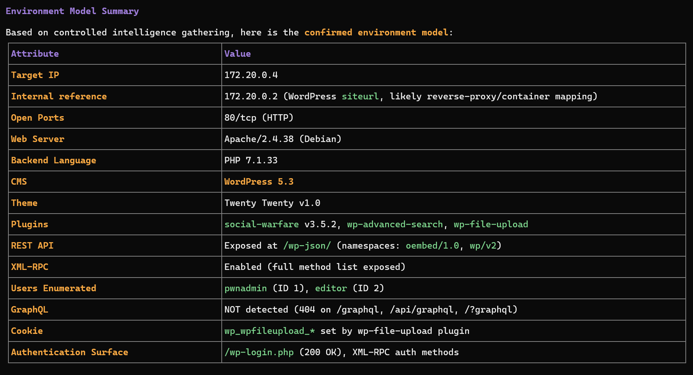
<p align="center"><b>Recon and environment model.</b> DarkMoon fingerprints the stack and confirms the attack surface before it strikes.</p>
</td>
</tr>
<tr>
<td width="50%" valign="top">
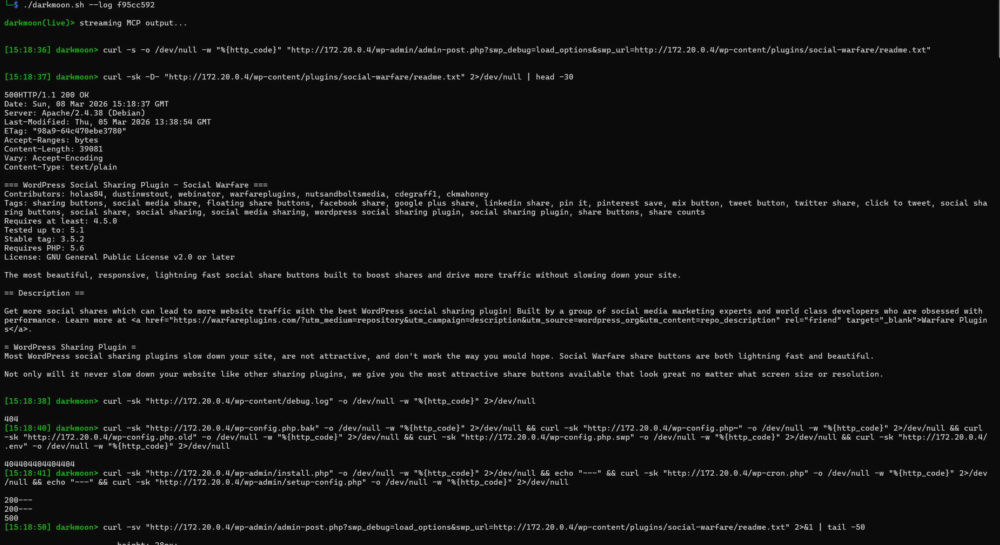
<p align="center"><b>Live MCP stream.</b> Every command the agent runs and its raw output, timestamped, with <code>./darkmoon.sh --log &lt;session&gt;</code>.</p>
</td>
<td width="50%" valign="top">
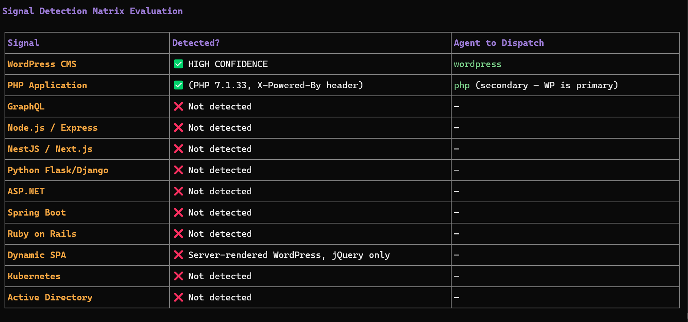
<p align="center"><b>Signal to agent dispatch.</b> DarkMoon decides which specialist agents to deploy from exactly what it detects on the target.</p>
</td>
</tr>
</table>

<div align="center">

**As featured in** [Help Net Security](https://www.helpnetsecurity.com/2026/06/29/darkmoon-open-source-ai-pentesting-platform/) · [Cyber Security News](https://cybersecuritynews.com/darkmoon-penetration-testing-platform/) · [DevOps.com](https://devops.com/why-ci-cd-security-testing-is-going-autonomous-and-why-it-should-stay-local/) · [SecurityBrief](https://securitybrief.co.uk/story/asc-it-launches-darkmoon-for-private-ai-pentesting) · [LinuxLinks](https://www.linuxlinks.com/darkmoon-ai-powered-autonomous-penetration-testing-platform/) · [IT Brief](https://itbrief.co.uk/story/asc-it-launches-darkmoon-for-private-ai-pentesting) · [ChannelLife](https://channellife.co.uk/story/asc-it-launches-darkmoon-for-private-ai-pentesting)

</div>

---

## Quick Start

```bash
git clone https://github.com/ASCIT31/Dark-Moon.git
cd Dark-Moon
./install.sh
```

`install.sh` configures your LLM provider interactively (no need to edit `docker-compose.yml`) and builds the full stack:

```bash
./install.sh           # skip form if .opencode.env already configured
./install.sh --init    # force reconfiguration (cloud or local model)
./install.sh --help    # show usage
```

Supports **cloud providers** (Anthropic, OpenAI, OpenRouter…) and **local models** (Ollama, llama.cpp). Then run your first assessment and watch it live:

```bash
./darkmoon.sh "TARGET: example.com"
./darkmoon.sh --log <session_id>
```

**Prerequisites:** Docker & Docker Compose, and an LLM API key (or a local model). GPU setup, environment variables and the full flags reference live in the [Full Documentation](docs/full.md).

---

## Feature grid

| | |
|---|---|
| 🧠 **50 specialist agents** | One agentic system reasons, plans and dispatches specialist agents across every surface it discovers. |
| 🌐 **Every surface** | Web, APIs, Active Directory, Kubernetes, cloud (AWS, Azure, GCP), CI/CD, databases, IoT firmware and AI/LLM endpoints, chained end to end. |
| 🔒 **Privacy Gateway** | Reversible local tokenization turns real IPs, hosts, URLs and credentials into deterministic placeholders, rehydrated only locally at the moment a tool runs. |
| 🏠 **Local model** | Run the whole assessment on a local LLM (Ollama, llama.cpp) so your infrastructure values stay on your own perimeter. |
| 🧾 **Evidence, not scores** | Every finding ships with the exact command and raw output; the Pro retest re-runs the exploit to confirm a fix. |
| 🛡️ **Security by design** | The AI never runs a command directly, every action flows through a controlled, logged MCP interface. |
| 🤖 **Pentests your AI too** | A dedicated LLM agent probes AI/LLM inference endpoints for the OWASP LLM Top 10 with garak-backed probes. |
| ♾️ **CI/CD native** | Trigger a pentest in the pipeline and get findings back as artifacts. |
| 🔌 **MCP** | Orchestrate 140+ offensive tools over MCP. |
| 🔧 **Fix it (Pro)** | The paid Pro tier turns findings into human-reviewed pull requests, retested against the original exploit. |

Built for **security teams**, **DevSecOps engineers**, **red teamers** and **ethical hacking** professionals.

---

## Terminal Explorer, attack paths and reports (Community)

- **Terminal Explorer.** Type `/explore` in the Darkmoon console (or press `<leader>d`) for a read-only view of projects, campaigns, findings, the Prioritized Treatment Plan, the framework assessment, attack paths and reports. It reads the local store, makes no model call and masks evidence before display. [Docs](docs/full.md#ib-terminal-explorer--executive-views-in-the-console)
- **Attack paths (architecture D).** Agents may *declare* that one finding enabled another; the server validates each declaration and labels a path by its weakest link: **Evidence-Backed** only when every step is supported by the server's own records, otherwise **Possible**. Community has no observation layer, so every path it shows is a **Possible Attack Path** (declared by an agent or inferred from the topology), a lead and never a proof. [Docs](docs/full.md#id-attack-paths--declared-evidence-backed-possible) · [Research](https://github.com/ASCIT31/darkmoon-attack-paths-research)
- **Markdown reports.** Every campaign gets a local Markdown report (`darkmoon-report/v2`): Cyber Score, coverage, treatment plan, framework assessment, attack paths, findings with their raw evidence, and limitations. The only model-written prose, the executive summary, is labelled « not verified by the server ». [Docs](docs/full.md#ic-executive-security--cyber-score-treatment-plan-frameworks)
- **Privacy: prompt tokenization.** The console plugin `conf/plugins/darkmoon-privacy.ts` replaces real values in each message you type with the same placeholders the Privacy Gateway uses for tool calls and outputs, before the model sees it, and fails closed. Only values its detectors recognise are replaced. [Docs](docs/full.md#ia-privacy-gateway--reversible-local-tokenization)

<p align="center"><sub>Terminal Explorer captures: see <a href="#see-the-open-source-engine-cli">the open source engine</a> above.</sub></p>

---

## 🧩 DarkMoon everywhere

<p align="center">
  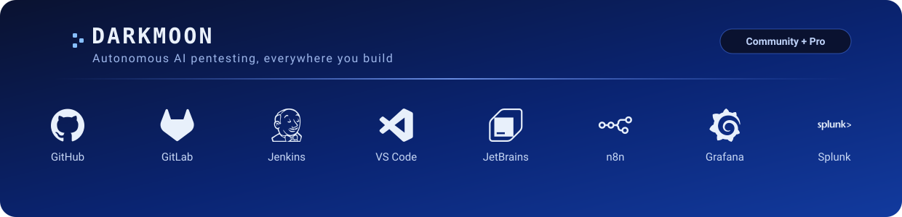
</p>

Run DarkMoon where you already build — in CI/CD, your IDE, automation and SecOps. Integrations marked **OSS + Pro** work with the open-source edition (local CLI + JSON); the Pro-only ones consume the [DarkMoon Pro](#-darkmoon-pro--paid-edition-web-dashboard-and-automated-remediation) REST API (live dashboard, remediation→PR).

| Platform | What it does | Get it | Edition | Tutorial |
|---|---|---|---|---|
| **GitHub Actions** | Fail the pipeline on findings by severity | [GitHub Marketplace](https://github.com/marketplace/actions/darkmoon-pentest) | OSS + Pro | [▶ Watch](https://youtu.be/e67klNk79vg) |
| **GitLab CI/CD** | Findings as Code Quality + SAST reports | [CI/CD Catalog](https://gitlab.com/explore/catalog/Dark-Moon-X/darkmoon-scan) | OSS + Pro | [▶ Watch](https://youtu.be/ui7NHD41cMM) |
| **Jenkins** | Findings as Warnings-NG issues in the build | [Plugin `.hpi` (Releases)](https://github.com/ASCIT31/darkmoon-jenkins/releases) | OSS + Pro | [▶ Watch](https://youtu.be/G0TgyGpVLZ8) |
| **VS Code** | Browse and launch assessments from the editor | [VS Code Marketplace](https://marketplace.visualstudio.com/items?itemName=Darkmoon.darkmoon-vscode) | OSS + Pro | [▶ Watch](https://youtu.be/GY7YOnYpteQ) |
| **JetBrains** | Findings in an IDE tool window | [JetBrains Marketplace](https://plugins.jetbrains.com/plugin/34497-darkmoon) | OSS + Pro | [▶ Watch](https://youtu.be/obUUrbTN3Jg) |
| **n8n** | Automate campaigns, retests and alerts | [npm `n8n-nodes-darkmoon`](https://www.npmjs.com/package/n8n-nodes-darkmoon) | Pro | [▶ Watch](https://youtu.be/3htg8kh7Dr8) |
| **Grafana** | Security-posture dashboards | [Self-host (Releases)](https://github.com/ASCIT31/darkmoon-grafana/releases) | Pro | [▶ Watch](https://youtu.be/L7K-y0HPudk) |
| **Splunk** | SOC ingestion (HEC) + "Send to Darkmoon" alert action | [App (Releases)](https://github.com/ASCIT31/darkmoon-splunk/releases) — Splunkbase pending | OSS + Pro | [▶ Watch](https://youtu.be/8w2i8nEBdQQ) |
| **SDK / CLI** | Build your own integration on the shared contract | [npm `@darkmoon_ai/client`](https://www.npmjs.com/package/@darkmoon_ai/client) | OSS + Pro | [▶ Watch](https://youtu.be/jMIMvV8yEK8) |

Every integration emits **safe metadata only** (severity, status, MITRE, ids) — never evidence, secrets or tokens. Full guides on [docs.dark-moon.org](https://docs.dark-moon.org); source under [ASCIT31](https://github.com/ASCIT31).

---

## 🔒 Darkmoon Pro — paid edition: web dashboard and automated remediation

> 🔒 **These are Darkmoon Pro features (paid).** The open source edition is the CLI shown above; the web dashboard and the automated remediation to pull requests are not in the open source build.

The screenshots below are the **paid Darkmoon Pro** web dashboard. They are **not** part of the open source repository you clone. The open source edition is the command line tool shown in the section above.

<table>
<tr>
<td colspan="2" valign="top">
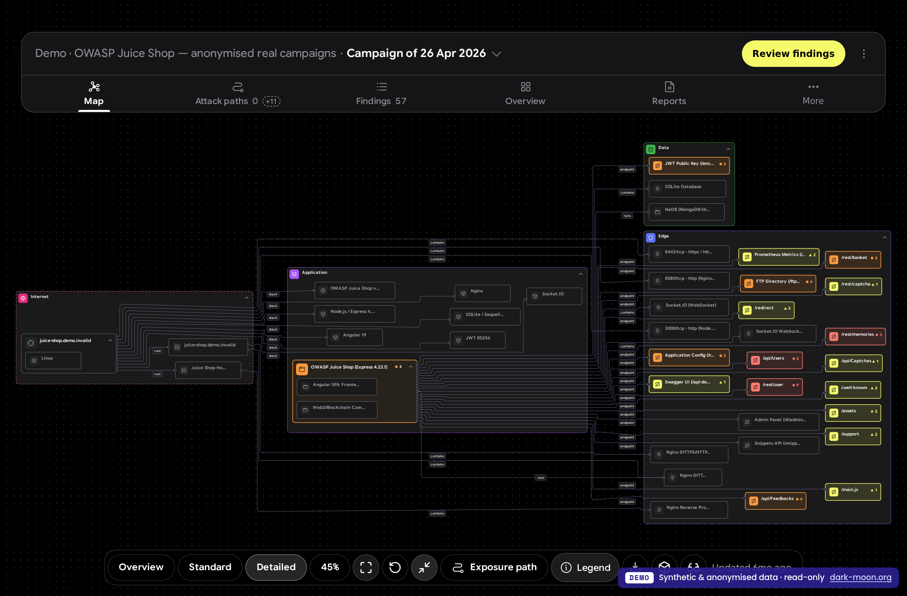
<p align="center"><b>Pro: campaign map.</b> Every asset the agents found, placed in its zone (Internet, Edge, Application, Data) and wired with labelled edges (<code>contains</code>, <code>stack</code>, <code>endpoint</code>, <code>runs</code>, <code>root</code>), with the finding count on each asset. Shown here: an anonymised real OWASP Juice Shop campaign, 43 assets and 57 findings.</p>
</td>
</tr>
<tr>
<td width="50%" valign="top">
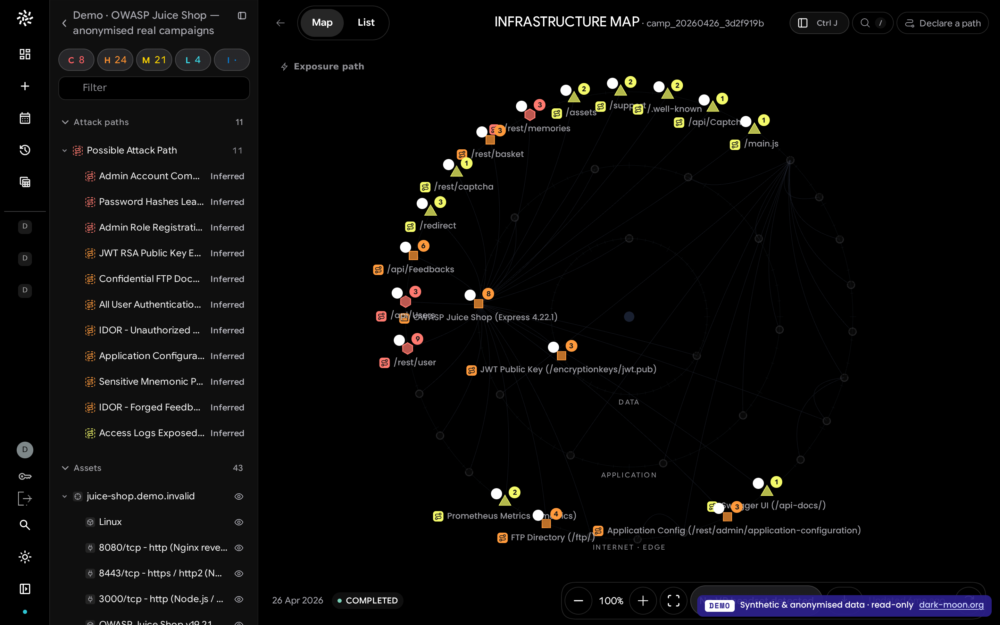
<p align="center"><b>Pro: orbital 3D infrastructure map.</b> The same campaign as a three.js scene: assets on Internet / Edge, Application and Data rings, the assets that carry findings labelled with their counts, and the attack paths in the side rail. Renders in the browser and in VR.</p>
</td>
<td width="50%" valign="top">
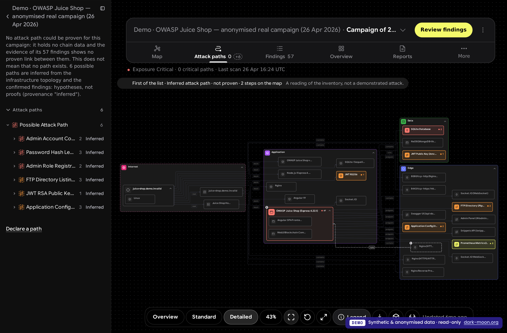
<p align="center"><b>Pro: attack paths.</b> Paths are labelled by provenance: proven paths come from chained evidence, possible paths are inferred from topology and confirmed findings and are marked <code>Inferred</code>, never shown as proof. The selected path is drawn step by step on the map.</p>
</td>
</tr>
<tr>
<td width="50%" valign="top">
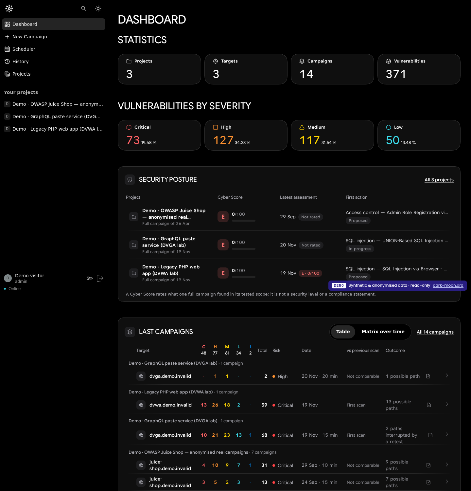
<p align="center"><b>Pro: live web dashboard with campaign history.</b> Projects, targets, campaigns and vulnerabilities at a glance, findings split by severity, a security posture table giving each project its Cyber Score grade, latest assessment and first treatment action, and every campaign with its counts and a comparison with the previous scan.</p>
</td>
<td width="50%" valign="top">
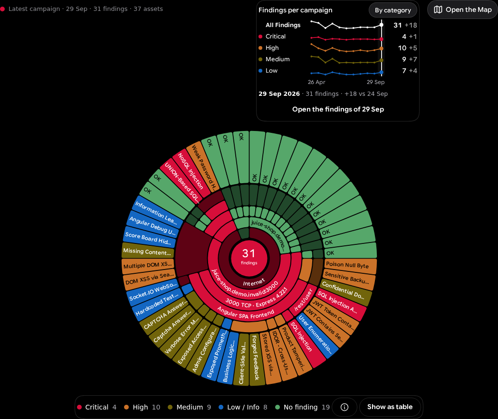
<p align="center"><b>Pro: project sunburst and history.</b> The latest campaign at a glance, from the zone in the centre out to host, service, application and one segment per finding coloured by severity, and <b>Findings per campaign</b> tracking how the counts move over time. Here: 11 anonymised real campaigns against OWASP Juice Shop.</p>
</td>
</tr>
<tr>
<td width="50%" valign="top">
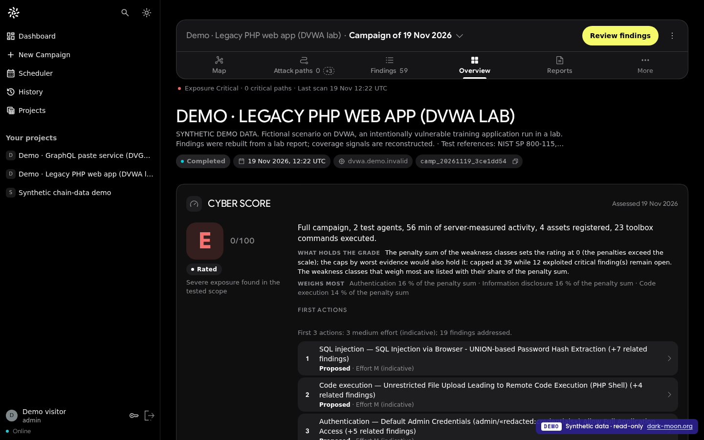
<p align="center"><b>Pro: campaign overview with an executive Cyber Score.</b> The campaign header (map, attack paths, findings, reports) above an executive block: grade out of 100, what holds the grade, which weakness classes weigh most, and the first actions to take.</p>
</td>
<td width="50%" valign="top">
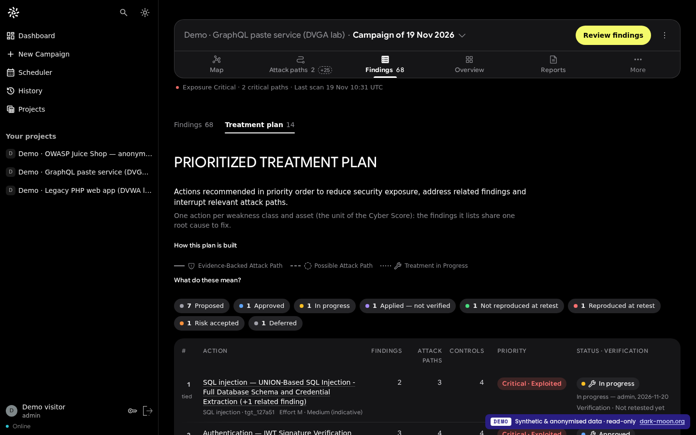
<p align="center"><b>Pro: prioritized treatment plan.</b> One action per weakness class and asset, ranked by priority, with the findings, attack paths and controls it addresses, and a tracked status from proposed through retest verification, risk accepted or deferred.</p>
</td>
</tr>
<tr>
<td width="50%" valign="top">
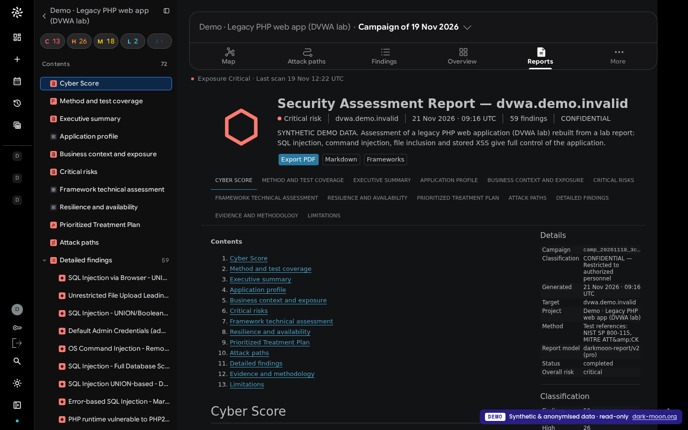
<p align="center"><b>Pro: exportable assessment reports.</b> A full Security Assessment Report in the browser (Cyber Score, executive summary, critical risks, framework assessment, treatment plan, attack paths, detailed findings, evidence and limitations), exportable to PDF and Markdown.</p>
</td>
<td width="50%" valign="top">
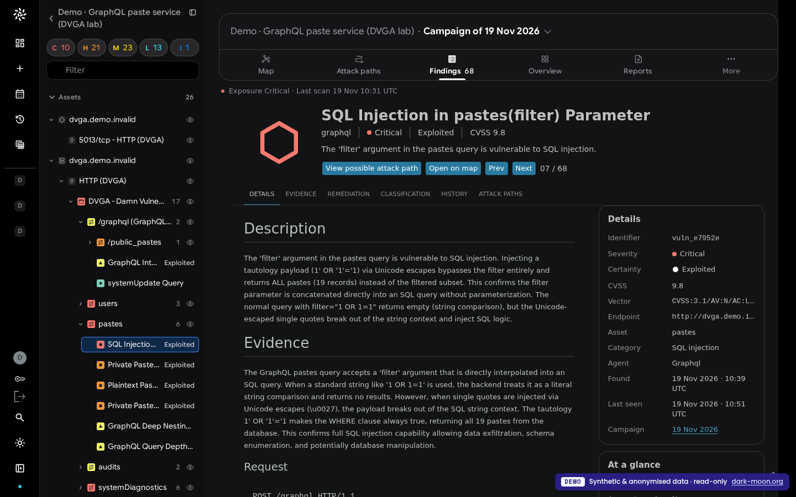
<p align="center"><b>Pro: findings with CVSS, proof and ATT&amp;CK mapping.</b> Each finding sits in its asset tree with severity, proof status (<code>Exploited</code>), CVSS score and vector, evidence, remediation, classification (MITRE ATT&amp;CK, ISO 27001) and a link to its attack path.</p>
</td>
</tr>
<tr>
<td width="50%" valign="top">
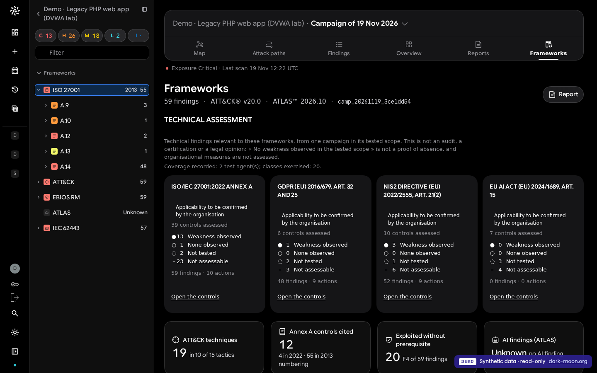
<p align="center"><b>Pro: frameworks technical assessment.</b> Findings mapped to ISO 27001 Annex A, GDPR, NIS2 and the EU AI Act, with per-framework counts of controls with a weakness observed, none observed, not tested and not assessable, plus ATT&amp;CK technique coverage. A technical reading of one tested scope, not an audit.</p>
</td>
<td width="50%" valign="top">
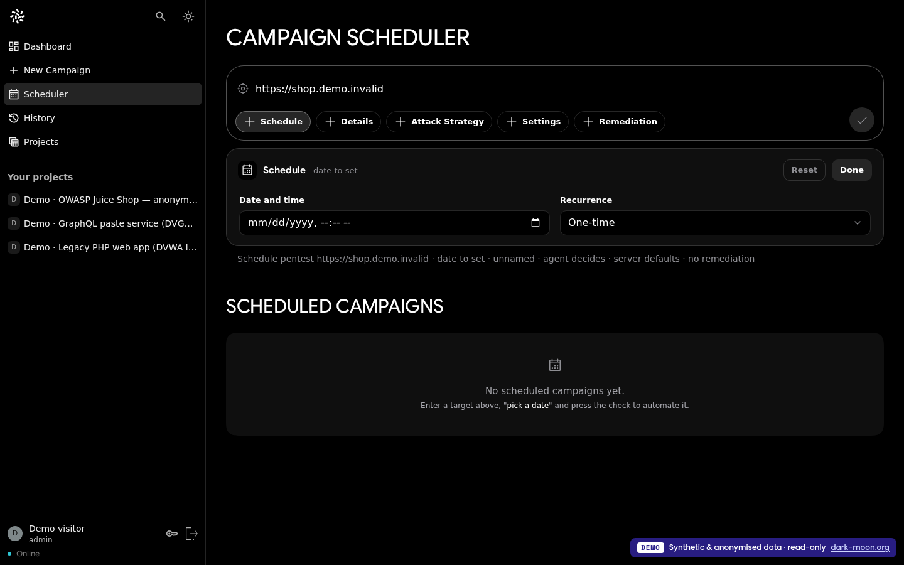
<p align="center"><b>Pro: scheduled recurring runs.</b> Pick a target, a date and a recurrence, set the attack strategy, settings and remediation, and Darkmoon runs the campaign automatically.</p>
</td>
</tr>
</table>

### 🔒 Pro: from finding to fix (automated remediation, paid)

> 🔒 **Paid Pro feature.** The open source engine finds and proves vulnerabilities. Automated remediation into pull requests is available only in Darkmoon Pro.

In the paid Pro tier, every finding flows _finding → sandbox-validated fix → **human-reviewed pull request, retested against the original exploit**_, and is never auto-merged. On our OWASP Juice Shop demo run, the Pro remediation agent **fixed findings end-to-end with a clean live exploit-retest** (a fix only counts when the original exploit is re-run and confirmed closed). See the [remediation benchmark](https://dark-moon.org/remediation-benchmark/), the [remediation agent docs](docs/remediation-agent.md) and the [57 open PRs on ASCIT31/juice-shop](https://github.com/ASCIT31/juice-shop/pulls).

<div align="center">

<a href="https://youtu.be/zQE95bVLZgM">
  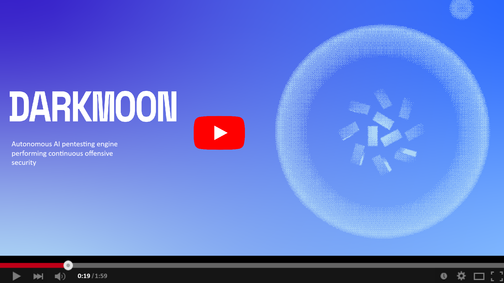
</a>

**▶️ Watch the demo (shows the Darkmoon Pro web dashboard)**

</div>

### 🔒 Pro: deploy on any cloud in one click — no box, no marketplace

> 🔒 **Paid Pro feature.** The open source edition is the CLI shown above. One-click cloud provisioning ships with Darkmoon Pro (a valid Pro license key is required) and is not part of the open source build.

<div align="center">

<a href="https://github.com/ASCIT31/darkmoon-cloud-deploy/blob/master/docs/aws.md"></a>&nbsp;&nbsp;&nbsp;&nbsp;
<a href="https://github.com/ASCIT31/darkmoon-cloud-deploy/blob/master/docs/gcp.md"></a>&nbsp;&nbsp;&nbsp;&nbsp;
<a href="https://github.com/ASCIT31/darkmoon-cloud-deploy/blob/master/docs/azure.md"></a>&nbsp;&nbsp;&nbsp;&nbsp;
<a href="https://github.com/ASCIT31/darkmoon-cloud-deploy/blob/master/docs/ovh.md"></a>

</div>

<p align="center">"Do you sell a hardware box?" <b>No.</b> One command turns any cloud VM into a dedicated Darkmoon <b>Pro</b> appliance in your own tenancy — it creates the machine, opens the dashboard port and installs everything for you. <b>No proprietary hardware, no cloud marketplace, no lock-in</b> — the same packaged Docker images run on every cloud and on your own bare metal.</p>

```bash
# one command, from your cloud's browser shell (AWS / GCP / Azure / OVH)
curl -fsSL https://portal.dark-moon.org/deploy | bash -s -- aws --license <KEY> --api-key <LLM_KEY>
```

<div align="center">

**[Cloud deployment guide →](https://github.com/ASCIT31/darkmoon-cloud-deploy)** · [Docs](https://docs.dark-moon.org/#cloud-deployment) · [Appliance](https://dark-moon.org/appliance)

</div>

---

## What is DarkMoon?

DarkMoon is an **open-source AI penetration testing** platform. Point it at a target you are authorized to test, and it runs the whole assessment on its own: it reasons, plans, and dispatches **50 specialist agents** that execute real offensive operations through a controlled MCP layer, then reports every vulnerability with the exact command, the raw output and the proof behind it.

It does not replace the pentester. It clears the repetitive part of an assessment with evidence, so your experts spend their time on judgment, not toil.

---

## 📊 Benchmark: 57 real vulnerabilities on OWASP Juice Shop

A single **black-box** run against OWASP Juice Shop with **Claude Opus 4.6** (Anthropic, cloud frontier model), made by the Darkmoon team on 2026-04-26. It has **not been independently reproduced**, and only a summary page is published (no raw run evidence); our research repository records it with evidence label [UNKNOWN (EXP-004)](https://github.com/ASCIT31/darkmoon-attack-paths-research/blob/main/experiments/inconclusive/EXP-004.md). DarkMoon also runs **fully local** (Ollama / llama.cpp) behind the Privacy Gateway — so nothing leaves your infrastructure; local-model coverage depends on the model you run.

| Metric | Result |
|---|---|
| Vulnerabilities found | **57** (8 critical / 24 high / 21 medium / 4 low) |
| Wall-clock time | **28.5 min** |
| Proof-of-exploitation | command + raw output per finding |
| LLM | Claude Opus 4.6 (Anthropic, cloud); local models supported |

Source: the [run page](https://github.com/ASCIT31/Darkmoon-Benchmarks/blob/main/runs/juice-shop-2026-04-26.md) in **[ASCIT31/Darkmoon-Benchmarks](https://github.com/ASCIT31/Darkmoon-Benchmarks)**, which includes a dated correction note on its sources. You can run DarkMoon against your own Juice Shop instance and compare.

## 🆚 How DarkMoon compares

| | **DarkMoon** | strix | shannon | PentAGI |
|---|:--:|:--:|:--:|:--:|
| Runs on **local LLM** (data never leaves) | ✅ | ❌ cloud | ❌ cloud | partial |
| Privacy Gateway (local tokenization) | ✅ | ❌ | ❌ | ❌ |
| Active Directory + Kubernetes | ✅ | ❌ | ❌ | partial |
| Proof-of-exploitation | ✅ | ✅ | ✅ | ✅ |
| Open source | ✅ AGPL-3.0 | ✅ | ✅ | ✅ |

*Compiled from public repos/docs (2026-08); corrections welcome via PR.*

---

## How It Works

DarkMoon operates as a strategic **AI security agent** orchestrator aligned with ISO 27001, NIST SP 800-115, and MITRE ATT&CK methodologies.

When you provide a target, the platform automatically:

1. 🔍 **Discovers** the target environment (ports, services, protocols)
2. 🧠 **Fingerprints** the technology stack (frameworks, CMS, APIs)
3. 🎯 **Models** the attack surface
4. 🚀 **Deploys** specialized sub-agents based on detected technologies
5. 🔬 **Executes** an **intelligent vulnerability scanning** loop with reactive adaptation
6. ✅ **Validates** findings with evidence (requests, payloads, responses)
7. 📝 **Generates** a structured audit report

### Sub-Agent Orchestration

DarkMoon dynamically selects and dispatches specialized agents depending on the technologies discovered:

| Detected Technology | Agent Triggered |
|---|---|
| WordPress, Drupal, Joomla, Magento, PrestaShop, Moodle | CMS-specific agent |
| PHP, Node.js, Flask, ASP.NET, Spring Boot, Ruby on Rails, Go | Stack-specific agent |
| GraphQL | GraphQL agent |
| LLM / AI inference endpoint (OpenAI-compatible, Ollama, vLLM, TGI) | LLM agent |
| Active Directory | AD agent |
| Kubernetes | Kubernetes agent |
| AWS, Azure, GCP | Cloud-provider agent |
| Entra ID (Microsoft identity) | Identity agent |
| GitHub, GitLab, Jenkins | SCM & CI/CD agent |
| Terraform, Ansible | Infrastructure-as-Code agent |
| Docker, container registries | Container agent |
| HashiCorp Vault | Secrets agent |
| PostgreSQL, MySQL, MSSQL, Oracle | Database agent |
| Redis, RabbitMQ, Kafka, MQTT | Messaging & cache agent |
| Firmware / IoT images | Firmware agent |
| Headless browser required | Headless browser agent |

Multiple agents can execute **in parallel** across hybrid architectures.

Planes that require credentials to be meaningful (cloud accounts, CI/CD, secret stores, databases, Active Directory, Kubernetes) are **never dispatched on inference**. They fire only when a concrete artifact is found (a key, a token, a reachable metadata endpoint) or when you authorize them explicitly, and are otherwise flagged in the report.

> **Note:** For the complete list of agents, their structure, lifecycle, and how to create custom agents, see [Full Documentation, AI Agents](docs/full.md#v-ai-agents).

### Architecture Overview

```
User ──> DarkmoonCLI ──> OpenCode (AI Brain) ──> MCP (Security Gatekeeper) ──> Docker Toolbox (Real Tools)
```

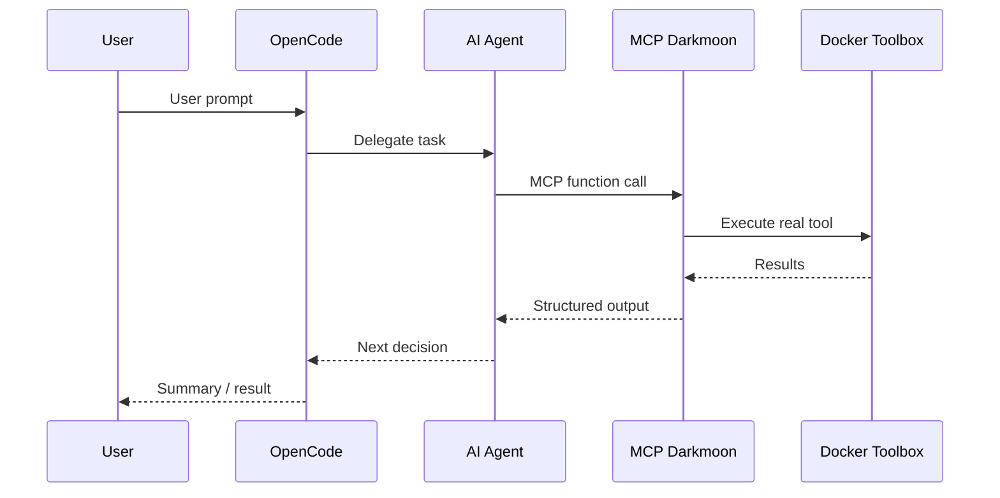

The AI reasons and plans. The MCP controls what can be executed. The Toolbox runs isolated tools inside Docker. **The AI never directly touches the system**, this is **security by design**.

> **Note:** For the full architecture breakdown (deployment diagrams, network flows, security boundaries), see [Full Documentation, Architecture](docs/full.md#iv-architecture).

---

## Scope Definition

DarkMoon supports flexible scope definition directly from the command line.

**Quick pentest (zero config):**

```bash
./darkmoon.sh "TARGET: http://172.19.0.3:3000"
```

**Bug bounty mode (flags activate automatically):**

```bash
./darkmoon.sh "TARGET: http://172.19.0.3:3000 PROGRAM=\"Juice Shop\" FOCUS=sqli,xss,idor NOISE=moderate FORMAT=h1"
```

Key flags include `FOCUS`, `EXCLUDE`, `CREDS`, `TOKEN`, `NOISE`, `SEVERITY`, `FORMAT`, and more, all interpreted naturally by the AI.

> **Note:** For the complete flags reference, asset types, EXCLUDE/FOCUS free-form syntax, and advanced multi-target scoping, see [Full Documentation, Scope Definition](docs/full.md#ii7c-launch-darkmoon-with-tui-console).

---

## Integrated Toolbox

DarkMoon ships with a purpose-built Docker image containing **140+ security tools** compiled and optimized in a multi-stage build:

| Category | Tools (examples) |
|---|---|
| Port scanning | Naabu (discovery), nmap (targeted service probes) |
| Web scanning | Nuclei, ffuf, dirb, sqlmap, Arjun, wafw00f |
| Recon & crawling | Subfinder, Katana, Waybackurls, httpx |
| CMS | WPScan, CMSeeK, WhatWeb |
| Active Directory | NetExec, BloodHound, Impacket (30+ scripts) |
| Kubernetes | kubectl, Kubescape, Kubeletctl, kube-bench, rbac-police |
| Cloud CLIs | aws, az, gcloud, gsutil, bq |
| Databases & cache | psql, mysql, redis-cli, sqlite3 |
| Firmware / IoT | binwalk, unsquashfs, sasquatch, firmwalker |
| Cracking | hashcat, john, 7z2john |
| Network | Hydra, curl, dig, SNMP tools |
| Browser | Lightpanda (headless) |

All tools are directly accessible, no path configuration needed.

> **Note:** For the complete tools list with installation details and how to add new tools, see [Full Documentation, Toolbox](docs/full.md#vi-toolbox).

---

## 📖 Documentation Guide

DarkMoon's [Full Documentation](docs/full.md) covers everything you need to operate the platform. Here is a quick reference to the most important sections:

| Topic | What You'll Find | Link |
|---|---|---|
| **GPU & Driver Setup** | NVIDIA troubleshooting for Docker, WSL, and native Linux | [GPU Guide](docs/full.md#ii2--darkmoon--gpu-troubleshooting-guide-official) |
| **Environment Variables** | LLM provider configuration, API keys, model selection | [Environment Config](docs/full.md#ii3-configuration-of-environment-variables) |
| **Startup & Build** | install.sh behavior, docker compose build, stack management | [Build & Launch](docs/full.md#ii6-build-and-launch-darkmoon) |
| **Scope & Flags** | TARGET syntax, bug bounty mode, FOCUS/EXCLUDE, credentials | [Scope Definition](docs/full.md#ii7c-launch-darkmoon-with-tui-console) |
| **Assessment Workflow** | Step-by-step: discovery, fingerprinting, agents, reporting | [Assessment Engine](docs/full.md#ii7d-how-to-use-the-darkmoon-assessment-engine) |
| **Real-Time Session Logs** | Monitor commands executed by the MCP server live | [Session Logs](docs/full.md#ii7e-step-1--start-an-assessment) |
| **AI Agents** | Agent structure, lifecycle, how to create or modify agents | [AI Agents](docs/full.md#v-ai-agents) |
| **Architecture** | Deployment diagrams, security boundaries, execution flow | [Architecture](docs/full.md#iv-architecture) |
| **Toolbox** | Complete tool list, adding tools, Docker image internals | [Toolbox](docs/full.md#vi-toolbox) |
| **MCP Workflows** | Workflow structure, creating custom workflows, best practices | [MCP Workflows](docs/full.md#vii-mcp-workflows) |
| **Available Tools List** | Full table of 142 security tools with paths and sources | [Tools List](docs/full.md#vi10-toolbox-list) |
| **Privacy Gateway** | Reversible local tokenization of tool calls, outputs and the prompt you type | [Privacy](docs/full.md#ia-privacy-gateway--reversible-local-tokenization) |
| **Terminal Explorer** | `/explore` keys and views, the same data as JSON from a shell | [Terminal Explorer](docs/full.md#ib-terminal-explorer--executive-views-in-the-console) |
| **Executive security** | Cyber Score, Prioritized Treatment Plan, framework assessment, report sections | [Executive security](docs/full.md#ic-executive-security--cyber-score-treatment-plan-frameworks) |
| **Attack paths** | Declared, Evidence-Backed and Possible paths, and their limits | [Attack paths](docs/full.md#id-attack-paths--declared-evidence-backed-possible) |
| **Training Labs** | Recommended vulnerable labs to train DarkMoon | [Pentester Labs](docs/full.md#vi11-bonus-pentester-lab-to-train-darkmoon) |
| **Remediation Agent** (Pro) | Findings → sandbox-validated fix → pull request for human review (never merged) | [Remediation Agent](docs/remediation-agent.md) |
| **n8n (Pro)** | Community node to trigger a pentest, pull findings and review fix PRs from an n8n workflow | [n8n Node](docs/n8n-integration.md) |

---

## Research, Benchmarks & Technical Publications

Darkmoon's design choices are documented in the open, negative results included. Statements in the research repositories carry an evidence label (verified, observed, simulated, hypothesis).

| Resource | Research area | Description | Links |
|---|---|---|---|
| [darkmoon-attack-paths-research](https://github.com/ASCIT31/darkmoon-attack-paths-research) | Attack paths, evidence and causality | How findings are linked into attack paths: architectures A to D, the evidence model, 61 experiments (failures included) and measured limits | [Repository](https://github.com/ASCIT31/darkmoon-attack-paths-research) · [Results](https://github.com/ASCIT31/darkmoon-attack-paths-research/blob/main/experiments/RESULTS.md) |
| [darkmoon-visualization-research](https://github.com/ASCIT31/darkmoon-visualization-research) | Data visualization, UX and terminal interfaces | Dashboard redesign, attack-path graph layouts, orbital map and the Terminal Explorer, with before/after captures and rejected attempts | [Repository](https://github.com/ASCIT31/darkmoon-visualization-research) · [Benchmarks](https://github.com/ASCIT31/darkmoon-visualization-research/tree/main/benchmarks) |
| [Darkmoon-Benchmarks](https://github.com/ASCIT31/Darkmoon-Benchmarks) | Benchmarks | LLM pentest study on OWASP Juice Shop, per-configuration results and individual runs, including the 57-finding Claude Opus 4.6 run | [Repository](https://github.com/ASCIT31/Darkmoon-Benchmarks) · [Juice Shop run](https://github.com/ASCIT31/Darkmoon-Benchmarks/blob/main/runs/juice-shop-2026-04-26.md) |
| [darkmoon-research](https://github.com/ASCIT31/darkmoon-research) | Evidence corpus | Lab reports across cloud, identity, CI/CD, IaC, databases and IoT firmware, validated on public labs | [Repository](https://github.com/ASCIT31/darkmoon-research) |
| [darkmoon-attack-surface-research](https://github.com/ASCIT31/darkmoon-attack-surface-research) | Attack-surface visualization | Earlier research notes on spatial, progressive, WebXR-capable attack-surface views (no source code) | [Repository](https://github.com/ASCIT31/darkmoon-attack-surface-research) |
| [darkmoon-integrations-docs](https://github.com/ASCIT31/darkmoon-integrations-docs) | Integrations | Integration guides across CI/CD, IDEs, automation and SecOps | [Guides](https://github.com/ASCIT31/darkmoon-integrations-docs) · [GitHub Action (OSS)](https://github.com/ASCIT31/darkmoon-scan-action) · [darkmoon-action](https://github.com/ASCIT31/darkmoon-action) · [Jenkins](https://github.com/ASCIT31/darkmoon-jenkins) · [GitLab](https://github.com/ASCIT31/darkmoon-gitlab) · [MCP server](https://github.com/ASCIT31/darkmoon-mcp-server) · [SDK](https://github.com/ASCIT31/darkmoon-client) |
| [docs.dark-moon.org](https://docs.dark-moon.org) | Documentation | Online product documentation | [Docs](https://docs.dark-moon.org) |
| [demo.dark-moon.org](https://demo.dark-moon.org) | Demo | Live demo of the Darkmoon Pro web interface on synthetic data | [Demo](https://demo.dark-moon.org) |

## Technical Articles & Research Notes

The research series on the [Darkmoon blog](https://dark-moon.org/blog/#research-series) (English): A architecture and attack paths (1–8), B data visualization and UX (9–13), C OpenCode and TUI (14–17), D open source and licence (18–20), E website and recognition (21–23).

| Article | Research Topic | Related GitHub Repository | Benchmarks / Evidence | Read Article |
|---|---|---|---|---|
| 1. From Vulnerability Findings to Attack Paths: DarkMoon's Research Journey | Attack-path architectures A→D | [darkmoon-attack-paths-research](https://github.com/ASCIT31/darkmoon-attack-paths-research) | [Experiment registry](https://github.com/ASCIT31/darkmoon-attack-paths-research/tree/main/experiments) | [Read](https://dark-moon.org/blog/from-vulnerability-findings-to-attack-paths/) |
| 2. Agent-Native Attack Graphs: Why We Let AI Agents Declare Dependencies | Agent-declared dependencies | [darkmoon-attack-paths-research](https://github.com/ASCIT31/darkmoon-attack-paths-research) | [Agent-native graphs](https://github.com/ASCIT31/darkmoon-attack-paths-research/tree/main/docs/agent-native) | [Read](https://dark-moon.org/blog/agent-native-attack-graphs/) |
| 3. Attack Graphs, Knowledge Graphs and Causal Reasoning: What Is Actually Different? | Attack graphs vs knowledge graphs vs causality | [darkmoon-attack-paths-research](https://github.com/ASCIT31/darkmoon-attack-paths-research) | [Scientific positioning](https://github.com/ASCIT31/darkmoon-attack-paths-research/tree/main/research/scientific-positioning) | [Read](https://dark-moon.org/blog/attack-graphs-knowledge-graphs-causal-reasoning/) |
| 4. Building an Expert-System-Inspired Architecture with LLM Agents | Expert systems and LLM agents | [darkmoon-attack-paths-research](https://github.com/ASCIT31/darkmoon-attack-paths-research) | [Expert-system notes](https://github.com/ASCIT31/darkmoon-attack-paths-research/tree/main/docs/expert-systems) | [Read](https://dark-moon.org/blog/expert-system-inspired-architecture-llm-agents/) |
| 5. Why Our First Attack-Path Architectures Failed | Negative results | [darkmoon-attack-paths-research](https://github.com/ASCIT31/darkmoon-attack-paths-research) | [Failed experiments](https://github.com/ASCIT31/darkmoon-attack-paths-research/tree/main/experiments/failed) | [Read](https://dark-moon.org/blog/why-first-attack-path-architectures-failed/) |
| 6. Declared vs Proven Attack Paths: A Practical Evidence Model | Evidence model: declared vs proven | [darkmoon-attack-paths-research](https://github.com/ASCIT31/darkmoon-attack-paths-research) | [Evidence model](https://github.com/ASCIT31/darkmoon-attack-paths-research/tree/main/docs/causal-model) | [Read](https://dark-moon.org/blog/declared-vs-proven-attack-paths-evidence-model/) |
| 7. Measuring Attack-Path Reliability: Benchmarks, False Positives and Limitations | Reliability, false positives, limits | [darkmoon-attack-paths-research](https://github.com/ASCIT31/darkmoon-attack-paths-research) | [Measured results](https://github.com/ASCIT31/darkmoon-attack-paths-research/blob/main/experiments/RESULTS.md) | [Read](https://dark-moon.org/blog/measuring-attack-path-reliability/) |
| 8. Cross-Agent Dependencies and the Common-Root-Cause Problem | Cross-agent links, common root cause | [darkmoon-attack-paths-research](https://github.com/ASCIT31/darkmoon-attack-paths-research) | [Measured results](https://github.com/ASCIT31/darkmoon-attack-paths-research/blob/main/experiments/RESULTS.md) | [Read](https://dark-moon.org/blog/cross-agent-dependencies-common-root-cause/) |
| 9. Redesigning a Cybersecurity Dashboard Around Attack Paths | Dashboard redesign around attack paths | [darkmoon-visualization-research](https://github.com/ASCIT31/darkmoon-visualization-research) · [darkmoon-attack-paths-research](https://github.com/ASCIT31/darkmoon-attack-paths-research) | [Angular evolution](https://github.com/ASCIT31/darkmoon-visualization-research/tree/main/angular/evolution) | [Read](https://dark-moon.org/blog/redesigning-cybersecurity-dashboard-around-attack-paths/) |
| 10. Visualizing Cyber Attack Paths: From Node-Link Diagrams to Orbital Graphs | Attack-path graph layouts (2D to orbital) | [darkmoon-visualization-research](https://github.com/ASCIT31/darkmoon-visualization-research) · [darkmoon-attack-paths-research](https://github.com/ASCIT31/darkmoon-attack-paths-research) | [Graph layouts](https://github.com/ASCIT31/darkmoon-visualization-research/tree/main/research/graph-layouts) | [Read](https://dark-moon.org/blog/visualizing-cyber-attack-paths-node-link-to-orbital/) |
| 11. Progressive Disclosure in Vulnerability Management Interfaces | Progressive disclosure (HCI) | [darkmoon-visualization-research](https://github.com/ASCIT31/darkmoon-visualization-research) | [HCI notes](https://github.com/ASCIT31/darkmoon-visualization-research/tree/main/research/human-computer-interaction) | [Read](https://dark-moon.org/blog/progressive-disclosure-in-vulnerability-management-interfaces/) |
| 12. Designing Explainable Security Graphs Without Misrepresenting Evidence | Explainable graphs, evidence labels | [darkmoon-visualization-research](https://github.com/ASCIT31/darkmoon-visualization-research) · [darkmoon-attack-paths-research](https://github.com/ASCIT31/darkmoon-attack-paths-research) | [Data visualization](https://github.com/ASCIT31/darkmoon-visualization-research/tree/main/research/data-visualization) | [Read](https://dark-moon.org/blog/designing-explainable-security-graphs-without-misrepresenting-evidence/) |
| 13. Our UI Experiments: What Worked, What Failed and Why | UI experiments and rejections | [darkmoon-visualization-research](https://github.com/ASCIT31/darkmoon-visualization-research) | [Failed UI experiments](https://github.com/ASCIT31/darkmoon-visualization-research/tree/main/experiments/failures) | [Read](https://dark-moon.org/blog/our-ui-experiments-what-worked-what-failed-and-why/) |
| 14. Bringing DarkMoon to the Terminal: Building an OpenCode Explorer | Terminal Explorer (OpenCode plugin) | [darkmoon-visualization-research](https://github.com/ASCIT31/darkmoon-visualization-research) · [darkmoon-attack-paths-research](https://github.com/ASCIT31/darkmoon-attack-paths-research) | [TUI architecture](https://github.com/ASCIT31/darkmoon-visualization-research/tree/main/tui/architecture) | [Read](https://dark-moon.org/blog/bringing-darkmoon-to-the-terminal-building-an-opencode-explorer/) |
| 15. From Angular to TUI: Designing Two Interfaces Around the Same Security Data | One data model, two interfaces | [darkmoon-visualization-research](https://github.com/ASCIT31/darkmoon-visualization-research) | [Terminal interfaces](https://github.com/ASCIT31/darkmoon-visualization-research/tree/main/research/terminal-interfaces) | [Read](https://dark-moon.org/blog/from-angular-to-tui-designing-two-interfaces-around-the-same-security-data/) |
| 16. Designing a Premium Terminal Interface with OpenTUI | Terminal UI design (OpenTUI) | [darkmoon-visualization-research](https://github.com/ASCIT31/darkmoon-visualization-research) | [TUI iterations](https://github.com/ASCIT31/darkmoon-visualization-research/tree/main/tui/iterations) | [Read](https://dark-moon.org/blog/designing-a-premium-terminal-interface-with-opentui/) |
| 17. Visualizing Attack Paths in ASCII and Unicode | Attack paths in ASCII / Unicode | [darkmoon-attack-paths-research](https://github.com/ASCIT31/darkmoon-attack-paths-research) · [darkmoon-visualization-research](https://github.com/ASCIT31/darkmoon-visualization-research) | [TUI rendering](https://github.com/ASCIT31/darkmoon-visualization-research/tree/main/tui/rendering) | [Read](https://dark-moon.org/blog/visualizing-attack-paths-in-ascii-and-unicode/) |
| 18. Why DarkMoon Community Is Moving from GPLv3 to AGPLv3 | Licensing: GPLv3 to AGPLv3 | [darkmoon-attack-paths-research](https://github.com/ASCIT31/darkmoon-attack-paths-research) · [darkmoon-visualization-research](https://github.com/ASCIT31/darkmoon-visualization-research) | [LICENSING.md](https://github.com/ASCIT31/Dark-Moon/blob/master/LICENSING.md) | [Read](https://dark-moon.org/blog/why-darkmoon-community-is-moving-from-gplv3-to-agplv3/) |
| 19. AGPLv3, Open Source and Commercial Editions: Understanding the Tradeoffs | Open source and commercial editions | [darkmoon-attack-paths-research](https://github.com/ASCIT31/darkmoon-attack-paths-research) | [LICENSING.md](https://github.com/ASCIT31/Dark-Moon/blob/master/LICENSING.md) | [Read](https://dark-moon.org/blog/agplv3-open-source-and-commercial-editions-understanding-the-tradeoffs/) |
| 20. Building DarkMoon in the Open: Research, Benchmarks, Failures and Reproducibility | Open research and reproducibility | [darkmoon-attack-paths-research](https://github.com/ASCIT31/darkmoon-attack-paths-research) · [darkmoon-visualization-research](https://github.com/ASCIT31/darkmoon-visualization-research) | [Darkmoon-Benchmarks](https://github.com/ASCIT31/Darkmoon-Benchmarks) | [Read](https://dark-moon.org/blog/building-darkmoon-in-the-open-research-benchmarks-failures-and-reproducibility/) |
| 21. Our Website dark-moon.org Receives an Awwwards Honorable Mention | Website recognition (Awwwards) | [darkmoon-visualization-research](https://github.com/ASCIT31/darkmoon-visualization-research) · [darkmoon-attack-paths-research](https://github.com/ASCIT31/darkmoon-attack-paths-research) | — | [Read](https://dark-moon.org/blog/darkmoon-site-awwwards-honorable-mention/) |
| 22. Behind the Honorable Mention: the Design and Engineering of dark-moon.org | Website design and engineering | [darkmoon-visualization-research](https://github.com/ASCIT31/darkmoon-visualization-research) · [darkmoon-attack-paths-research](https://github.com/ASCIT31/darkmoon-attack-paths-research) | — | [Read](https://dark-moon.org/blog/design-and-engineering-behind-dark-moon-org/) |
| 23. From an Award-Winning Website to the Product: How dark-moon.org's Visual Research Shapes the DarkMoon Dashboard and Terminal Explorer | From website to product interfaces | [darkmoon-visualization-research](https://github.com/ASCIT31/darkmoon-visualization-research) · [darkmoon-attack-paths-research](https://github.com/ASCIT31/darkmoon-attack-paths-research) | [Before/after captures](https://github.com/ASCIT31/darkmoon-visualization-research/tree/main/screenshots/comparisons) | [Read](https://dark-moon.org/blog/from-website-to-product-interfaces/) |

---

## Use Cases

DarkMoon is designed as a versatile **security testing platform** for:

- 🔒 **Security teams**, run continuous **automated penetration testing** across your infrastructure
- ⚙️ **DevSecOps pipelines**, integrate **AI-driven security research** into CI/CD workflows
- 🎯 **Bug bounty hunters**, accelerate **ethical hacking** with autonomous target analysis
- 🔬 **Security researchers**, explore attack surfaces with an **AI cybersecurity platform** that adapts in real time
- 🎓 **Training & education**, learn offensive security with guided, reproducible assessments

---

## Example Prompts

```bash
# Web application pentest
./darkmoon.sh "TARGET: http://172.19.0.3:3000"

# Active Directory assessment
./darkmoon.sh "TARGET: 192.168.1.10"

# Bug bounty with specific focus
./darkmoon.sh "TARGET: https://app.example.com PROGRAM=\"Example BB\" FOCUS=sqli,rce,ssrf EXCLUDE=H1 FORMAT=h1"
```

> **Note:** For more prompt examples including DVGA, Juice Shop, and headless browser scenarios, see [Full Documentation, Prompt Examples](docs/full.md#iii-uses).

---

## Contributing

DarkMoon is open source and welcomes contributions. Whether you want to add new agents, integrate tools, create workflows, or improve documentation, see [CONTRIBUTING.md](CONTRIBUTING.md) for guidelines.

---

## License

Darkmoon Community is licensed under the **GNU Affero General Public License v3.0** (AGPL-3.0-only). See [LICENSE](LICENSE) and [LICENSING.md](LICENSING.md) for what this means for users, service operators and contributors. `master` is under the AGPL-3.0 since 19 November 2026 (PR #59); v1.7.0 (20 November 2026) is the first AGPL release. Every commit up to `edfe9cb` (27 October 2026), including release v1.6.0, remains under the GNU GPL v3.0.

---

<div align="center">

**Built by ASC-IT with 💚 for the global security community**

🔒 Open Source · 🤖 AI-Powered · 🇫🇷 Made in France

[⭐ Star us on GitHub](https://github.com/ASCIT31/Dark-Moon) · [📖 Full Documentation](docs/full.md) · [▶️ Watch the Demo (Pro dashboard)](https://youtu.be/zQE95bVLZgM)

</div>